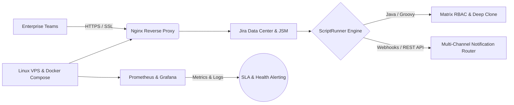

  <!-- High-Contrast Neon Cyan Animated Header -->
  

  

    <b>🏛️ Architecting Enterprise Atlassian Ecosystems (Data Center & Cloud) & Resilient Linux/Docker Infrastructures ⚙️</b>
  

  <!-- Perfectly Aligned 1-Row Action Bar -->
  

    
    
    
    
  

  <!-- Perfectly Aligned 1-Row Executive Metrics -->
  

    
    
    
    
  

---

### ⚡ Executive Profile & Track Record

- 🏆 **Senior Jira Administrator & Atlassian Solution Architect** leading enterprise configurations across **Actechco**, **MashhadHost**, and **IranHotel Online**—governing 200–280+ user environments across 7+ departments (Engineering, Infrastructure, Product, HR, CRM).
- ☕ **ScriptRunner (Java / Groovy) & Custom Routing Specialist:** Deep mastery of the **Atlassian Java API**—architecting **Multi-Channel Notification Routers**, Matrix RBAC validations, In-Memory Deep Cloning, and asynchronous DOM security locks.
- 🐧 **DevOps & Linux Infrastructure Operations:** Hands-on execution deploying containerized services via **Docker & Docker Compose**, configuring **Nginx** reverse proxies, scripting automated health checks in **Bash/Python**, and managing multi-VPS network tunnels (**Iran ↔ Germany routing**).
- 📊 **ITIL, BPMN & Data-Driven Governance:** Translating complex business logic into **BPMN 2.0** workflows and executive OKR/KPI/SLA telemetry using **Power BI**, **Looker Studio**, **eazyBI**, **Prometheus**, and **Grafana**.

---

### 🗺️ Enterprise Architecture & Automation Blueprint

---

### 🛠️ Core Tech Stack & Ecosystem

  **🟦 Atlassian Ecosystem, ITSM & Process Engineering**
   
  
  
  
  
  

   

  **☕ Backend Scripting, Automation & Integrations**
   
  
  
  
  
  
  

   

  **🐧 DevOps, Linux Infrastructure & Analytics**
   
  
  
  
  
  
  

---

### 💎 Production Case Studies (ScriptRunner, Java/Groovy & DevOps)

| 🎯 Enterprise Challenge | ⚙️ Architectural Solution & Production Code | 🔗 Code |
| :--- | :--- | :---: |
| **1. Matrix RBAC via User Properties** *(Zero Custom Field Bloat)* | Engineered sub-50ms live validation using `OSUser PropertySets` (`jira.meta.SalesLevel`), bypassing `setFilter` `MissingMethodException` on system fields. | [Assignee](https://github.com/yasin321/jira-devops-automation-scripts/blob/main/MatrixAccessControl_Assignee.groovy) [MultiUser](https://github.com/yasin321/jira-devops-automation-scripts/blob/main/MatrixAccessControl_MultiUserPicker.groovy) |
| **2. In-Memory Deep Issue Cloning** *(Dynamic Schema Post-Function)* | Eliminated hardcoded field mapping anti-patterns via native `issueFactory.cloneIssue()` in Heap memory + `IssueIndexingService` for Data Center cluster sync. | [Groovy](https://github.com/yasin321/jira-devops-automation-scripts/blob/main/DeepClone_MultiAssignee_PostFunction.groovy) |
| **3. Defense-in-Depth "Assign to Me"** *(3-Layer UI + API Governance)* | Combined **Server-Side Behaviours**, **Web Fragments**, and an **Agile Board `MutationObserver` (JS)** to block unauthorized self-assignment across SPA boards. | [3-Layer](https://github.com/yasin321/jira-devops-automation-scripts/blob/main/TripleLayer_AssignRestriction_Solution.md) [Fragment](https://github.com/yasin321/jira-devops-automation-scripts/blob/main/Hide_AssignToMe_WebFragment.md) |
| **4. Permission Scheme Leak Scanner** *(Jira 9/10 Type-Safe Diagnostics)* | Built an in-memory `SchemeEntity` X-Ray scanner using strict Groovy typing (`O(N)` cached lookup) to detect `BROWSE_PROJECTS` security leaks. | [Scanner](https://github.com/yasin321/jira-devops-automation-scripts/blob/main/PermissionScheme_Leak_Scanner.md) |
| **5. Static Type Checking Standards** *(High-Load Node Safety)* | Eliminated Monaco Editor NBSP syntax traps and enforced explicit `FormField` casting to prevent `NullPointerException` in Data Center nodes. | [Guide](https://github.com/yasin321/jira-devops-automation-scripts/blob/main/Jira_Behaviour_Initialiser_Standard.md) |

---

### 🖧 Infrastructure & Containerization Repositories

- **[🐧 `linux-infra-and-monitoring`](https://github.com/yasin321/linux-infra-and-monitoring):** Production-ready `Docker Compose` observability stack (**Prometheus + Grafana**), **Nginx** reverse proxy routing (`nginx.conf`), and automated **Bash** tunnel latency/health checks (`network_tunnel_check.sh`).
- **[⚛️ `noor-app` (Containerized Web Platform)](https://github.com/yasin321/noor-app):** Full-stack TypeScript/React application packaged with a **Multi-Stage Dockerfile** (`node:20-alpine` + `nginx:alpine`) and automated GitHub Actions workflows.

---

### 💬 Peer Endorsements (From LinkedIn Recommendations)

> *"Yasin is without a doubt one of the most professional, ethical, and dependable colleagues I've worked with. He has an exceptional command of Agile frameworks combined with deep technical expertise in Jira configuration, workflow design, custom fields, dashboards, and automation."*  
> — **Farnaz Tehranpour**, HR Specialist

> *"His passion and strong technical character make him valuable and dynamic, enabling any engineering and business environment he works with to run smoothly."*  
> — **Muhamed Sadeq Rakhshani Moqadam**, DevOps Engineer

---

### 📈 GitHub Telemetry & Code Breakdown

  
  

  

---

  <h3>🤝 Let's Connect & Build Resilient Systems</h3>
  
I regularly publish hands-on architectural teardowns on <b>Jira Data Center</b>, <b>ScriptRunner (Java/Groovy)</b>, and <b>DevOps Automation</b> on LinkedIn.

  

